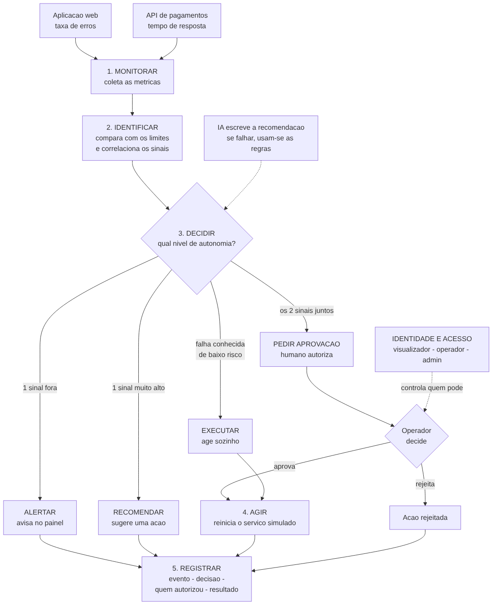
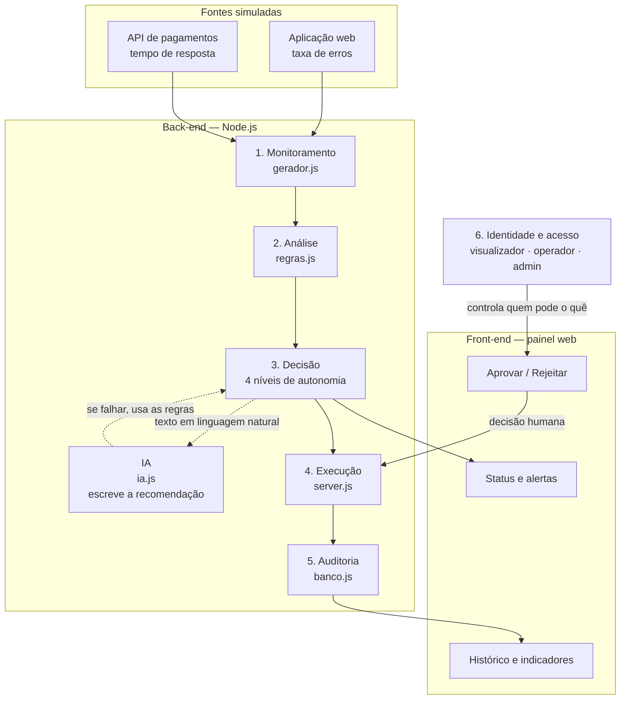

# 2. Arquitetura

A solução é modular, como o desafio pede: monitoramento, análise, decisão,
execução, identidade e auditoria. Cada módulo tem uma responsabilidade só, e
isso é o que permite trocar uma parte sem quebrar as outras.

## Diagrama

O mesmo fluxo, em detalhe:

## Os módulos

| # | Módulo | Arquivo | O que faz |
| --- | --- | --- | --- |
| 1 | Monitoramento | `backend/gerador.js` | Gera e coleta as métricas das duas fontes |
| 2 | Análise | `logica/regras.js` | Compara com os limites e correlaciona os sinais |
| 3 | Decisão | `logica/regras.js` | Define o nível de autonomia da resposta |
| — | IA | `logica/ia.js` | Escreve a recomendação para o operador ler |
| 4 | Execução | `backend/server.js` | Executa a ação ou espera a aprovação |
| 5 | Auditoria | `backend/banco.js` | Grava evento, decisão, autorização e resultado |
| 6 | Identidade | `backend/server.js` | Verifica o perfil em cada pedido |

## Por que a IA fica fora da decisão

A IA **não escolhe** o nível de autonomia. Quem escolhe são as regras, que são
determinísticas e auditáveis: dado o mesmo valor, a decisão é sempre a mesma.

A IA só traduz a decisão em uma frase que o operador entende. Se o modelo cair,
estiver sem chave ou demorar demais, o sistema usa o texto das regras e segue
funcionando. O painel mostra a origem de cada recomendação, então fica visível
quando a IA foi usada.

Essa separação responde à pergunta mais provável da banca: **"e se a IA errar?"**

## Fluxo de um pedido

1. O painel chama `GET /status` a cada 3 segundos.
2. O back-end gera uma leitura nova das duas fontes.
3. As regras recebem os valores e devolvem o nível de autonomia.
4. Se o nível **mudou**, cria-se um evento (senão o histórico encheria de linhas
   repetidas).
5. Conforme o nível, o sistema alerta, recomenda, cria uma ação pendente ou
   executa sozinho.
6. Tudo é gravado na auditoria com os quatro campos exigidos.
